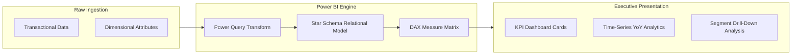

<p align="center">
  
</p>

<p align="center">
  
  
  
  
  
</p>

---

## Executive Summary / Overview
### Problem Statement & Context
Modern enterprises generate massive volumes of transactional and operational data across siloed domains. Without robust Business Intelligence (BI) modeling, decision-makers face fragmented views, inaccurate forecasting, and unmonitored operational bottlenecks, impairing revenue retention and capital efficiency.

### Solution Overview
This repository contains a comprehensive suite of enterprise-grade business analysis artifacts and interactive **Power BI reports (`.pbix`)**. It implements Star Schema dimensional modeling, custom DAX (Data Analysis Expressions) metrics, time-intelligence computations, and executive KPI scorecards designed to drive data-informed decision-making.

---

## Interactive Table of Contents
- [Executive Summary / Overview](#executive-summary--overview)
- [Key Features & Capabilities](#key-features--capabilities)
- [System Architecture / Pipeline](#system-architecture--pipeline)
- [Tech Stack Breakdown](#tech-stack-breakdown)
- [Reproducible Quickstart & Setup](#reproducible-quickstart--setup)
- [Project Directory Layout](#project-directory-layout)
- [Author & Contributions](#author--contributions)

---

## Key Features & Capabilities
- **Multi-Dimensional Star Schemas:** Clean relational data models separating Fact transactions from Conformed Dimensions (Time, Customer, Region, Product).
- **Advanced DAX KPI Engineering:** Dynamic measures computing Year-over-Year (YoY) growth, Month-over-Month (MoM) variances, rolling moving averages, and profit margin distributions.
- **Executive Diagnostic Visualizations:** Interactive cross-filtering, drill-through hierarchies, and Pareto distribution analysis for rapid anomaly detection.
- **End-to-End Enterprise Reports:** Rigorous technical documentation (`.docx`) establishing analytical methodology, assumption validation, and business transformation roadmaps.

---

## System Architecture / Pipeline


---

## Tech Stack Breakdown
| Layer | Technology | Purpose |
| :--- | :--- | :--- |
| **Languages** | DAX, Power Query M | Data transformations, calculated metrics, time-intelligence |
| **Libraries** | Power BI Visual Engine | Interactive charts, decomposition trees, KPI cards |
| **Tools** | Microsoft Power BI Desktop, Office Suite | Dashboard modeling, dataset compilation, technical reporting |
| **Architecture** | Kimball Star Schema Dimensional Modeling | Fact and Dimension relational decoupling |

---

## Reproducible Quickstart & Setup
```bash
# 1. Clone repository
git clone https://github.com/suryateja-155/Business-Analysis-Projects.git
cd Business-Analysis-Projects

# 2. Prerequisites
# Ensure Microsoft Power BI Desktop is installed on your Windows workstation.

# 3. Open Interactive Dashboards
# Launch any of the compiled Power BI project files:
start "BA Assignment Surya.pbix"
start "BA Experiment 2.pbix"
```

---

## Project Directory Layout
```text
Business-Analysis-Projects/
├── BA Assignment Surya.pbix       # Power BI interactive report and data model
├── BA Experiment 2.pbix          # Comparative analytics and secondary dashboard
├── BA assignment.docx            # Business requirements document and analysis plan
├── BA Report-2.docx              # In-depth executive analysis and variance report
├── PowerBi Project Surya.docx    # Complete project specification and KPI glossary
└── README.md                     # Engineering documentation and technical guide
```

---

## Author & Contributions

**Gettupalli Surya Teja**  
- GitHub Profile: [@suryateja-155](https://github.com/suryateja-155)  
- Portfolio Index: [Gettupalli-Surya-Teja](https://github.com/suryateja-155/Gettupalli-Surya-Teja)

Contributions, issue reports, and feedback are always welcome! Feel free to open an issue or pull request.

<p align="center">
  
</p>
